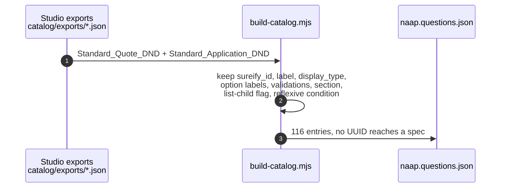
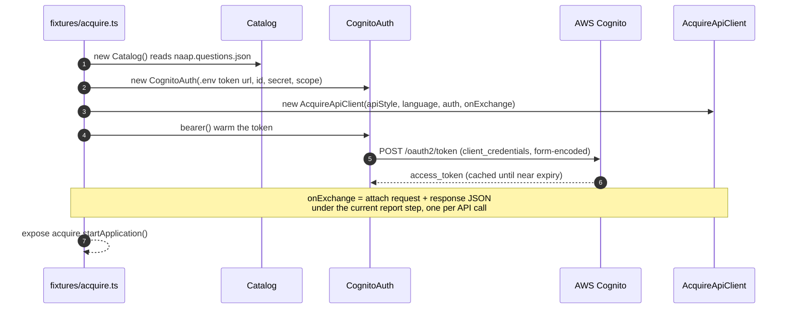
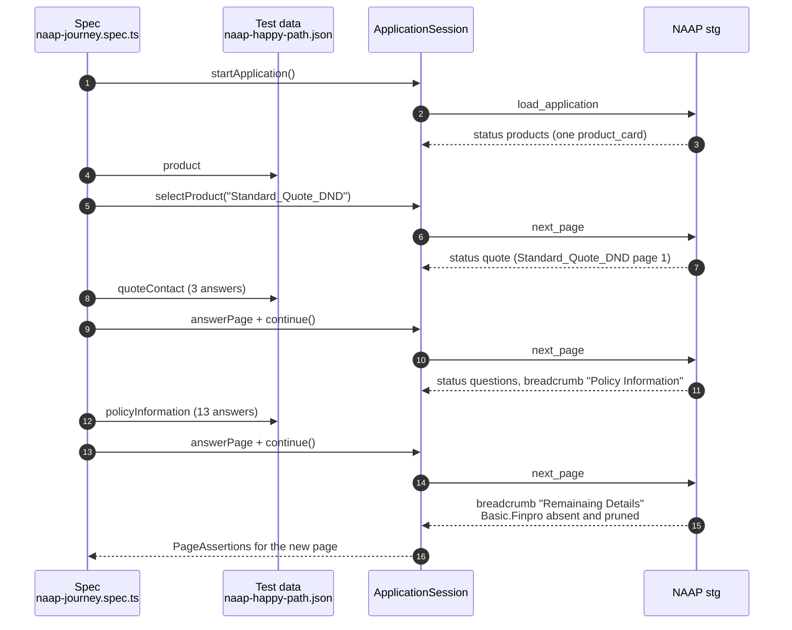
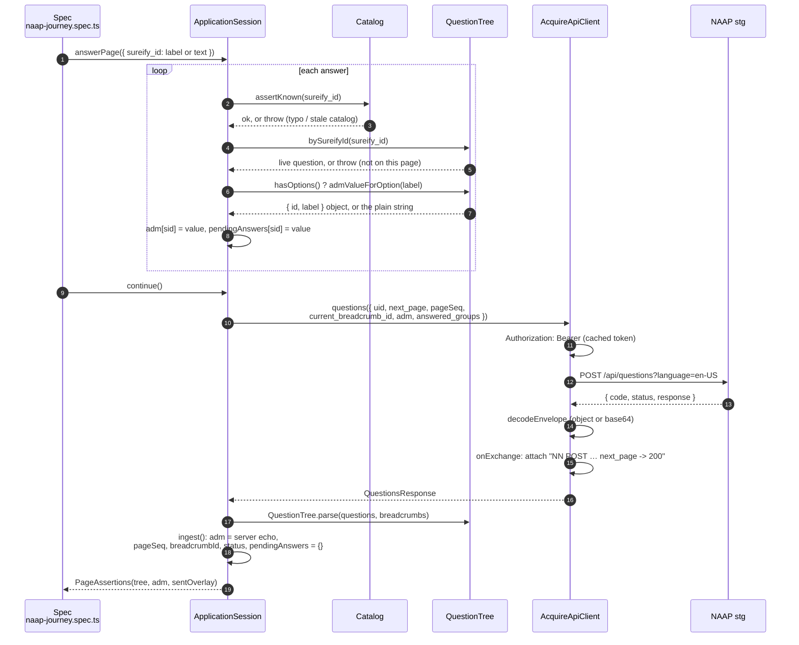
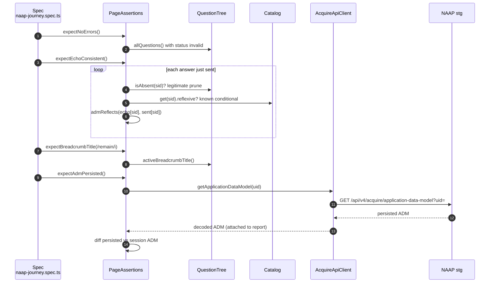

# Sequence diagrams — how catalog, client, engine and test data work together

Traced from `tests/naap-journey.spec.ts` ("policy information page submits clean and
advances"), `test-data/naap-happy-path.json`, `fixtures/acquire.ts`, `src/catalog/catalog.ts`,
`src/engine/*` and `src/client/*`. Every arrow exists in code. Five small diagrams, one per
concern, rather than one wall. Render with any Mermaid viewer (VS Code Markdown preview).

## 1. Authoring time — building the catalog (offline, once)

## 2. Fixture setup — hidden from the report (boxed)

## 3. The journey at page level — what the spec sees

## 4. One round trip in detail — answerPage() then continue()

This is the loop every page goes through. Response N defines request N+1.

## 5. Oracles — assertions read state, never the request

## Reading the diagrams

- **Test data → Catalog → Tree → ADM** (diagram 4) is the resolve-on-write path. A spec
  never carries a UUID: the catalog validates the sureify_id, the live tree turns an option
  label into the `{id, label}` object the engine expects, and the result goes into the ADM.
- **Every response passes through `ingest()`** before anything else happens. The next
  request is built only from `uid`, `pageSeq`, `breadcrumbId`, `answeredGroups` and the
  echoed ADM plus the overlay just answered.
- **The client is the only layer that knows URLs, auth and the envelope.** The fixture's
  `onExchange` hook is why each call shows up as a JSON attachment under its journey step.
- **Oracles read state, not requests** (diagram 5). The sent overlay is used only to know
  which keys to look for in the echo.
- Not shown: `triggerApi()` (page_state_change) and `list()` (ListBuilder). No current spec
  uses them, and the list protocol is known to be wrong for this engine
  (see `reflexive-questions-assessment.md`).
