# Sequence diagrams — how catalog, client, engine and test data work together

Traced from `tests/naap-journey.spec.ts` ("policy information page submits clean and
advances"), `test-data/naap-happy-path.json`, `fixtures/acquire.ts`, `src/catalog/catalog.ts`,
`src/engine/*` and `src/client/*`. Every arrow exists in code. Five small diagrams, one per
concern, rather than one wall. Render with any Mermaid viewer (VS Code Markdown preview).
Diagrams 6 to 14, further down, cover `tests/naap-product-journey.spec.ts`.

## 1. Authoring time — building the catalog (offline, once)

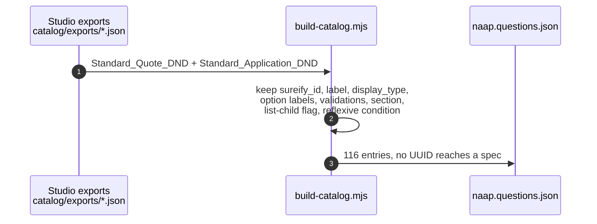

## 2. Fixture setup — hidden from the report (boxed)

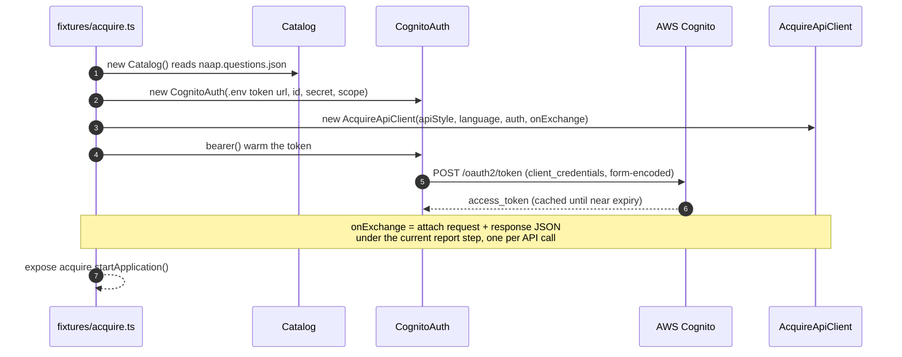

## 3. The journey at page level — what the spec sees

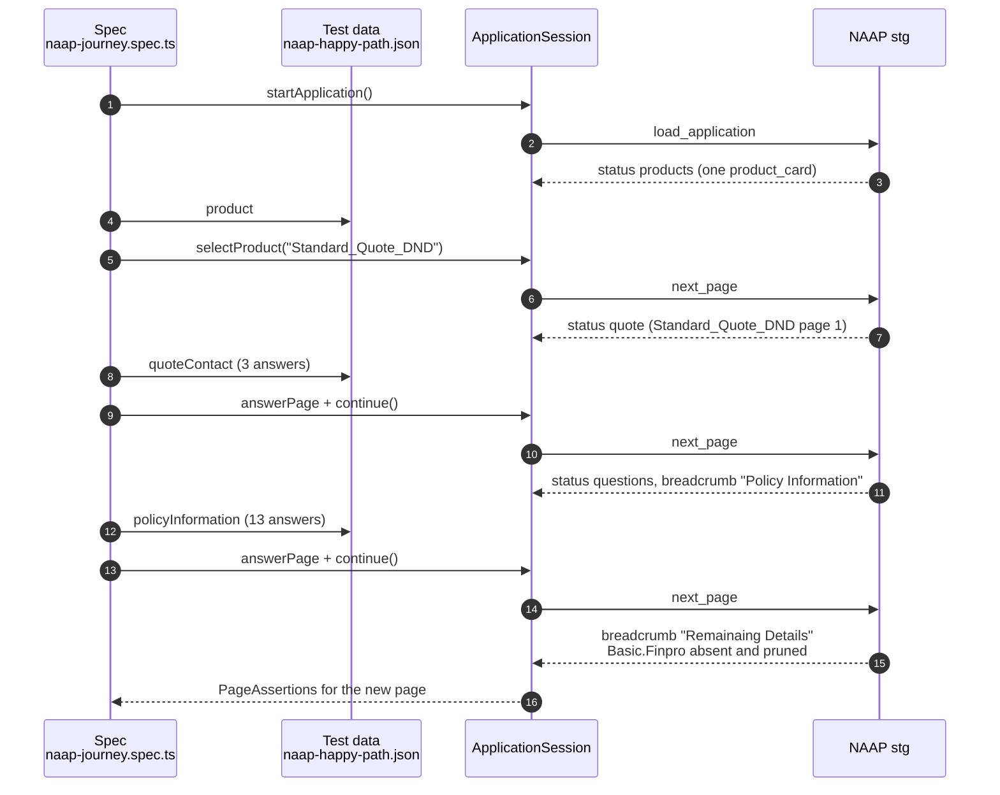

## 4. One round trip in detail — answerPage() then continue()

This is the loop every page goes through. Response N defines request N+1.

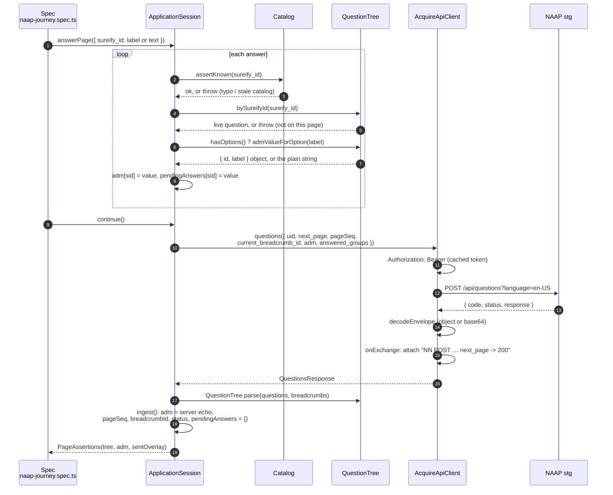

## 5. Oracles — assertions read state, never the request

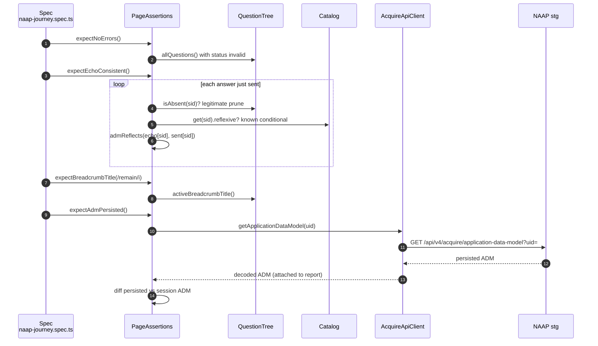

## Reading the diagrams

- **Test data → Catalog → Tree → ADM** (diagram 4) is the resolve-on-write path. A spec
  never carries a UUID: the catalog validates the sureify_id, the live tree turns an option
  label into the `{id, label}` object the engine expects, and the result goes into the ADM.
- **Every response passes through `ingest()`** before anything else happens. The next
  request is built only from `uid`, `pageSeq`, `breadcrumbId`, `answeredGroups` and the
  echoed ADM plus the overlay just answered.
- **The client is the only layer that knows URLs, auth and the envelope.** The fixture's
  `onExchange` hook is why each call shows up as a JSON attachment under its journey step.
- **Oracles read state, not requests** (diagram 5). The sent overlay is used only to know
  which keys to look for in the echo.
- Not shown: `triggerApi()` (page_state_change). No current spec uses it.

---

# Product journey — `tests/naap-product-journey.spec.ts`

Traced from `tests/naap-product-journey.spec.ts`, `test-data/naap-product-journey.json`,
`fixtures/acquire.ts` (`startFromAgentPanel`), `src/engine/ApplicationSession.ts`,
`src/engine/ListBuilder.ts` and `src/client/AcquireApiClient.ts`. Diagrams 2, 4 and 5 above
still apply unchanged: the fixture, the answerPage/continue round trip and the oracles are the
same. The diagrams below cover only what this spec adds.

## 6. The whole journey as server states

`other_params.current_status` after each call. Two sessions take part: the Agent's
(one uid) and the Insured's (a second uid, issued after the identity check).

```mermaid
stateDiagram-v2
    direction LR
    state "quote<br/>Case Setup" as quote
    state "questions<br/>ten application pages" as questions
    state "role_switching<br/>waits for Insured" as waitInsured
    state "challenge<br/>identity check" as challenge
    state "questions<br/>Terms of Use" as terms
    state "signature<br/>signing city and state" as signature
    state "e-signature<br/>documents to sign" as esign
    state "role_switching<br/>waits for Agent Signature" as waitAgent

    [*] --> quote: cutover + open
    quote --> questions: Get Your Quote, continue
    questions --> questions: continue (pages 1 to 9)
    questions --> waitInsured: last continue offers hand-off,<br/>passTo Insured
    waitInsured --> challenge: openNextRoleSession
    challenge --> challenge: wrong zip code
    challenge --> terms: verifyIdentity, uid issued
    terms --> signature: accept terms, continue
    signature --> esign: city and state, continue
    esign --> waitAgent: sign, passTo Agent
    waitAgent --> [*]
```

## 7. Agent-panel start — cutover, then open by uid

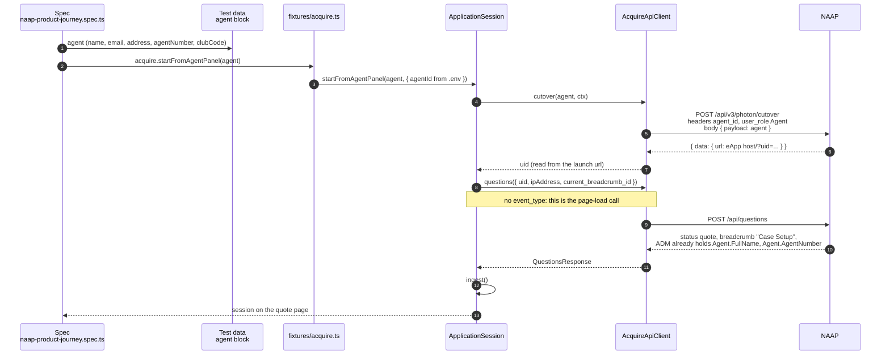

## 8. Get Your Quote — a button that calls an API

`callButtonApi('CalculateButton')` reads everything from the live button question. Nothing is
submitted to the question API here: the result rides along on the next `continue()`.

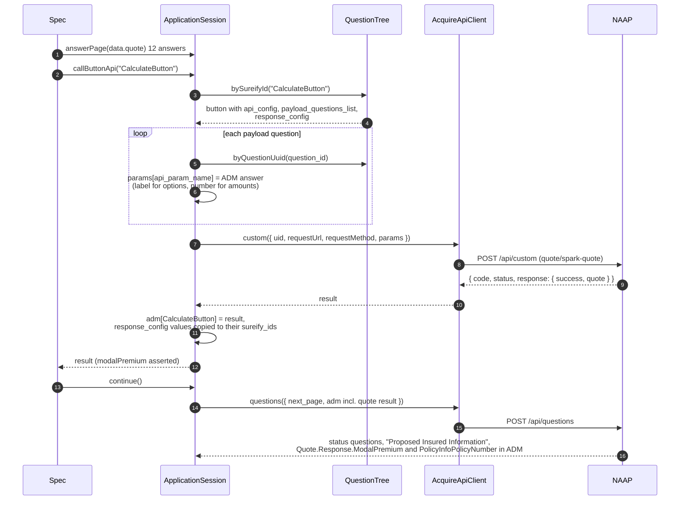

## 9. The Agent's ten pages and the hand-off offer

The page order is the key order of `pages` in the test data. Each key is a breadcrumb title.

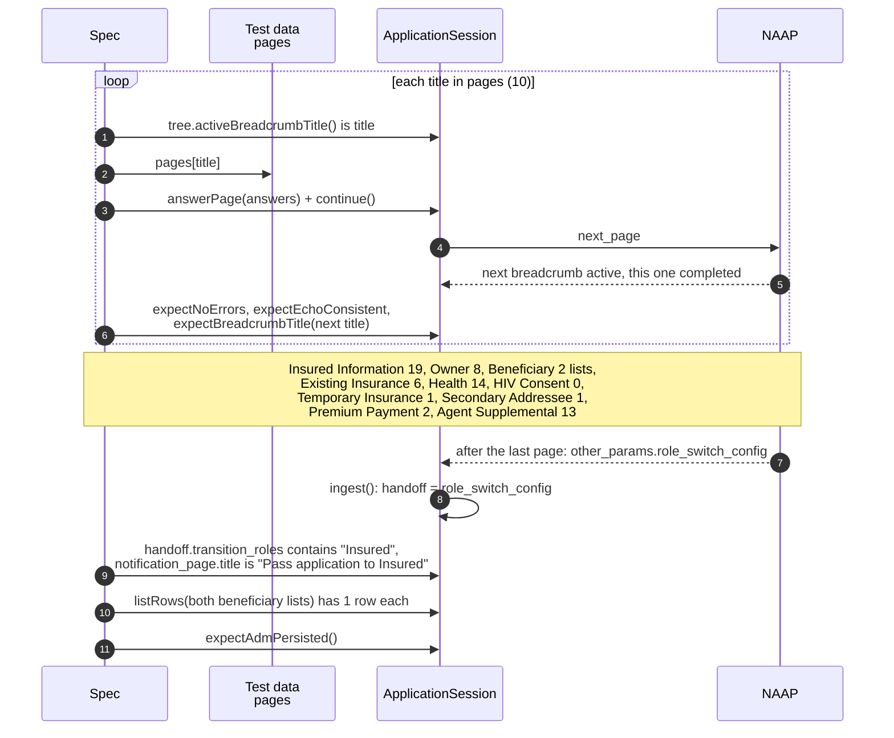

## 10. List answers — beneficiaries

A list has no events of its own. Its answer is the whole list, stored under the list
question's sureify_id and sent with the page on `continue()`.

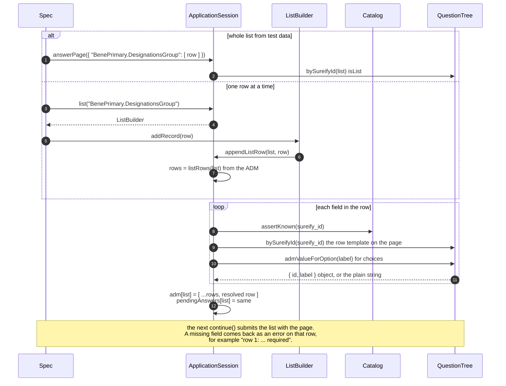

## 11. Role hand-off — Agent to Insured

The Insured's session is a separate `ApplicationSession`. Until the identity check passes it
has no uid and is addressed by the `euid` from the launch link.

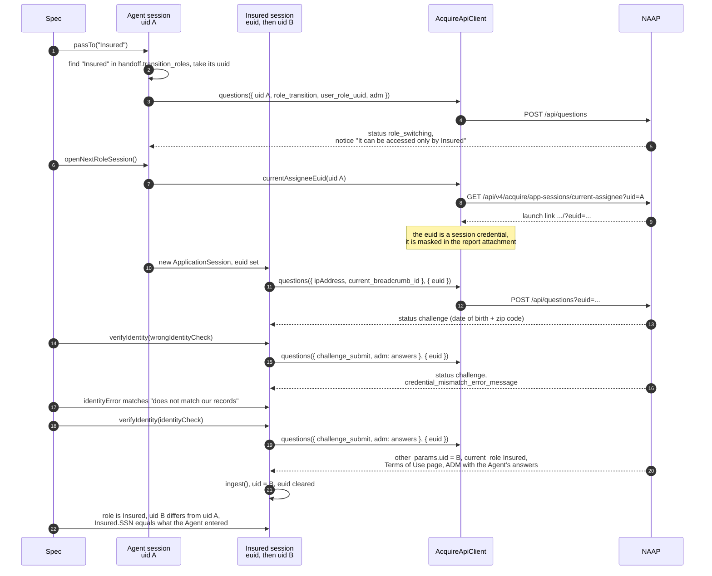

## 12. Insured stage — terms, signature page, e-signature

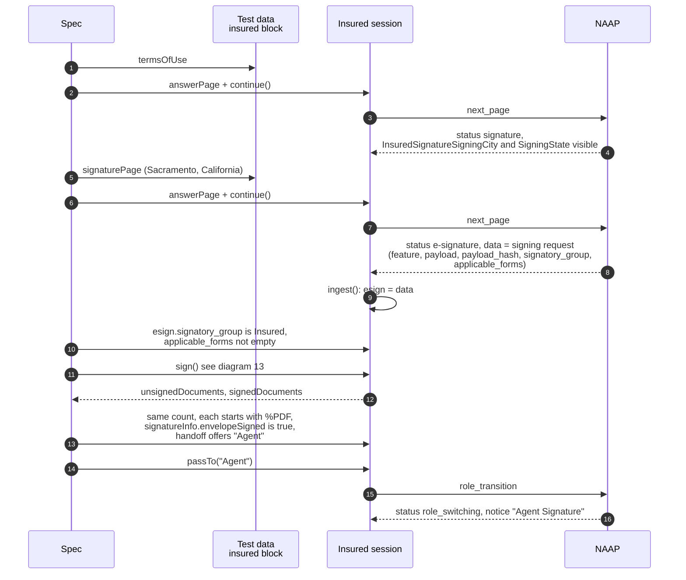

## 13. sign() in detail — question API and signing service

Every value in a request comes from the response before it. Document generation is a queued
job; if the result stream stays silent the same request is queued again, up to three times.

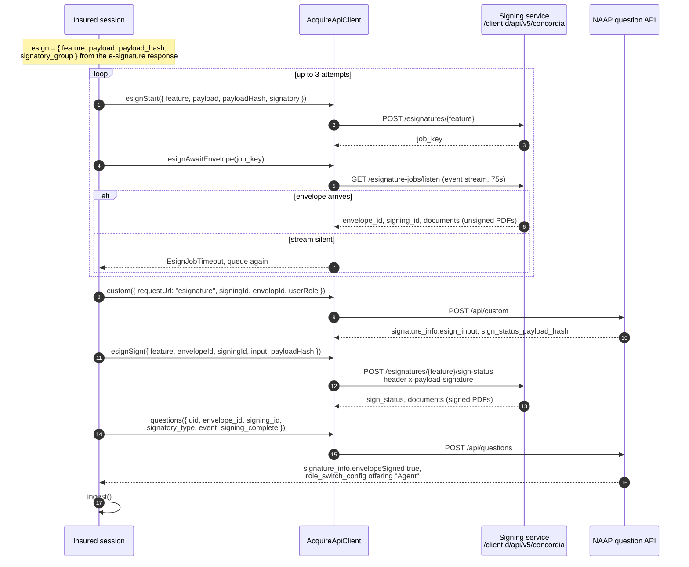

## 14. Which test travels how far

The spine is the journey. Each test box points at the place where that test makes its
assertions. The four rejection tests assert that the page did not advance.

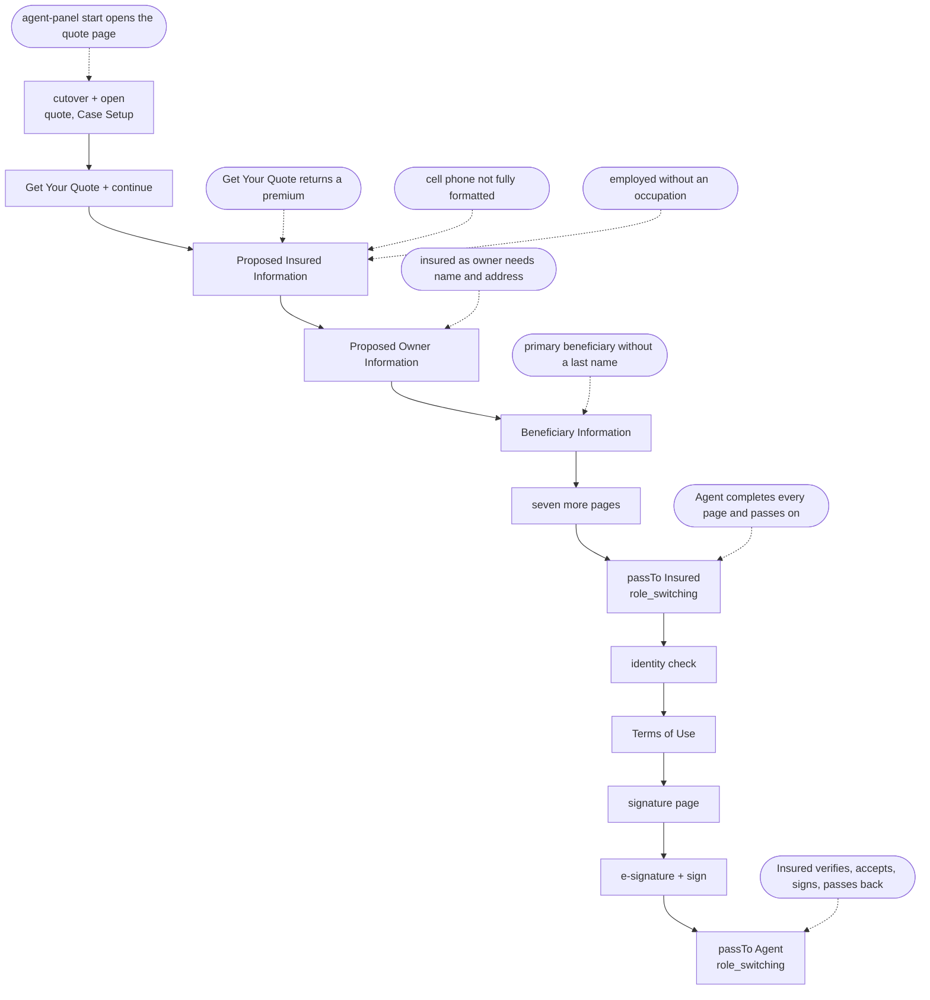

## Reading the product-journey diagrams

- **Two entry points, one loop.** `startFromAgentPanel()` replaces `start()` + `selectProduct()`
  (diagram 7). After that the same answerPage/continue loop from diagram 4 runs every page.
- **A role switch is two things.** `passTo()` is one `role_transition` call on the current
  session. The next role then works in a session of its own (diagram 11): new uid, same
  application data.
- **The hand-off needs no mailbox.** The launch link the email would carry is read from
  `app-sessions/current-assignee`.
- **Signing leaves the question API and comes back** (diagram 13). The signing service
  generates and signs the PDFs; the question API only registers the envelope and is told
  when signing is complete.
- **Test data drives the order.** The keys of `pages` are the breadcrumb titles in journey
  order, so adding or reordering a page is a test-data change, not a spec change.
